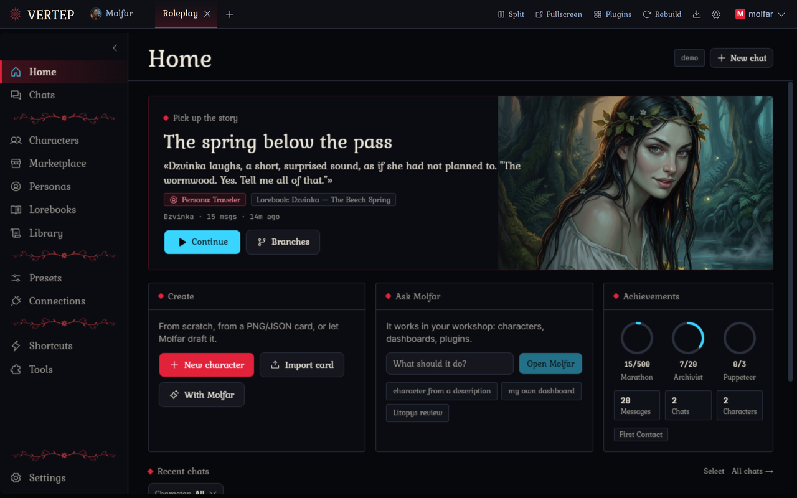

  
  <h1>Molfar Vertep</h1>
  
<b>Ролевой фронтенд, который живёт у тебя на машине, а внутри — агент, который пересобирает его по твоей просьбе.</b>

  

    
    
    
  

  

    
    
  

  
<a href="README.md">English</a> · <a href="README.uk.md">Українська</a> · <b>Русский</b>

> [!NOTE]
> **В работе.** Molfar Vertep молодой и меняется почти каждый день, так что ты встретишь баги. На этом этапе это нормально: открой [issue](https://github.com/MolfarWav/Molfar.Vertep/issues), и обычно это чинится в следующем патче.
>
> **Вайбкодинг в открытую.** Всё, что мы построили здесь после форка, в движке и в приложении Roleplay, написано AI-агентами, пока мы описывали, смотрели и правили; никто не набирал этот код руками. Это часть эксперимента: приложение, сделанное просьбами, которое ты и дальше меняешь просьбами.

## Что это такое

Molfar Vertep — место для длинных ролевых чатов с AI-персонажами: карточки, персоны, лорбуки, групповые сцены, всё обычное. Работает на твоём же компьютере или телефоне и открывается в браузере. Модель подключаешь свою: API-ключ, вход по подписке или что-то запущенное локально.

Вся разница в Мольфаре. Это агент, который живёт внутри (по нраву старый карпатский мольфар), и он умеет менять само приложение. Каждое приложение здесь — папка обычных файлов. Скажи Мольфару, что мешает или что хочется, и он поправит эти файлы; экран пересоберётся через несколько секунд, и ты сразу посмотришь результат.

## Меняй словами

Большинство фронтендов дают тебе настройки. Здесь можно ещё сказать «перемести эту кнопку», «добавь бросок кубика», «сделай чат как страницы книги», «покажи, кто что знает о моём персонаже». Мелкие правки и целые новые разделы идут тем же путём.

Пара вещей делает это удобным, а не страшным:

- **Каждое изменение можно откатить.** Мольфар работает в git: каждый запуск оставляет контрольную точку, и один клик возвращает код назад.
- **Перед крупным он спрашивает.** Для больших или неясных просьб Мольфар сначала спрашивает, с вариантами на выбор. Пути, которые ты пометишь защищёнными, каждый раз требуют твоего да.
- **Твои правки переживают обновления.** Когда выходит новая версия приложения, она сливается с тем, что ты поменял. Если они затрагивают одно и то же, выбираешь ты: оставить своё, взять новое или попросить Мольфара свести их вместе.
- **Приложения тоже могут его звать.** В приложении Roleplay есть кнопка «Ask Molfar», она открывает его с уже набранной твоей просьбой. Ничего не уходит, пока ты не нажмёшь Send.
- **Работает и с маленькими моделями.** Бесплатные модели с окном 32k автоматически получают более лёгкий промпт, так что Мольфар всё равно помещается.

Немалая часть Roleplay, который ты видишь ниже, сделана именно так: мы просили Мольфара, смотрели, просили снова.

### Сделай Мольфара своим

- **Навыки (скиллы).** Навык (скилл) — короткая инструкция для одного типа задач: «как я люблю свои карточки персонажей», «как пишутся лорбуки для этого мира». Пиши свои или позволь Мольфару предложить навык после удачной задачи; ничего не сохранится, пока ты не скажешь да.
- **Проекты.** Держи свои чаты с Мольфаром в проектах. У проекта свои инструкции, навыки (скиллы), память, файлы, которые ты добавляешь (заметки, референсы, картинки), и модель по умолчанию, так что чат, начатый там, уже знает контекст. Каждое установленное приложение — тоже проект.
- **Память.** Мольфар хранит заметки о тебе и твоей работе между чатами и спрашивает тебя перед тем, как записать каждую.

## Что уже внутри

**Roleplay** — первое приложение. Экран приветствия предлагает его при первом запуске, а новые версии приходят через кнопку «Обновления».

<table>
  <tr>
    <td width="50%"></td>
    <td width="50%"></td>
  </tr>
  <tr>
    <td><b>Главная.</b> Продолжи последнюю историю, начни новую, найди чат по персоне или персонажу.</td>
    <td><b>Чаты.</b> Читается как страница книги. Свайпы, ветки, групповые сцены, правка и перегенерация на любом сообщении.</td>
  </tr>
  <tr>
    <td></td>
    <td></td>
  </tr>
  <tr>
    <td><b>Дашборд отношений.</b> После каждого ответа он отмечает, что изменилось: доверие, настроение, кто что узнал, где и когда сцена, какие сюжетные линии открыты. Персонажи получают это обратно перед ответом.</td>
    <td><b>«Soul» (душа).</b> У каждого персонажа свой нрав: как быстро он теплеет, что его ранит, с чего начинается его отношение. Черновик собирается из карточки; ты правишь.</td>
  </tr>
  <tr>
    <td></td>
    <td></td>
  </tr>
  <tr>
    <td><b>Память истории.</b> Litopys (Летопись) пишет короткую главу после каждой сцены и хранит факты: о ком они, кто их знает, насколько они важны. Старые сообщения уходят из промпта, а главы остаются, так что длинный чат всё равно влезает в окно маленькой модели. В «Library» (библиотеке) можно прочесть и поправить всё это.</td>
    <td><b>Мольфар рядом с приложением.</b> Раздели экран: Мольфар с одной стороны, приложение с другой, изменения появляются по мере того, как он их делает.</td>
  </tr>
  <tr>
    <td></td>
    <td></td>
  </tr>
  <tr>
    <td><b>Карточка в полях.</b> Вкладка Profile разбивает персонажа на секции: идентичность, внешность, личность, поведение, цели, предыстория, отношения и другое. Выключай то, что тебе не нужно, чтобы маленькая модель платила только за включённое. «Structure it» сортирует текст старой карточки по полям, «Fill empty» просит модель заполнить пробелы, «Read from picture» заполняет внешность с портрета. Карточка всё равно сохраняется как обычный текст, так что её прочитает любое другое приложение.</td>
    <td><b>Твоя персона — так же.</b> Персоны получают те же поля, плюс пять коротких вопросов, которые напишут описание за тебя. «Structure it» сортирует вставленную персону по полям.</td>
  </tr>
  <tr>
    <td></td>
    <td></td>
  </tr>
  <tr>
    <td><b>Доска «Промпт».</b> Канва показывает каждую часть запроса чата по порядку, с токенами и суммой. Отключай любую часть только для этого чата, смотри, почему что-то взято или пропущено, и обрезай историю: последние N сообщений, только твои или только персонажа, без блоков размышлений. Отключённая часть ничего не стоит: Летопись, дашборд или лорбук тогда вообще не работают для этого чата.</td>
    <td><b>Карта твоих историй.</b> Чаты, которые продолжают друг друга, становятся карточками с проводами между ними. Перетаскивай чаты из списка с поиском, по одному или целой цепочкой; чат-продолжение получает прошлую историю как предысторию.</td>
  </tr>
  <tr>
    <td colspan="2"></td>
  </tr>
  <tr>
    <td colspan="2"><b>Быстрые ходы.</b> Под длинным черновиком: «Продолжить», «Напиши за меня» («Undo» возвращает твой черновик), «Другой ответ» и большой редактор на пол-экрана или на весь.</td>
  </tr>
</table>

А ещё мелочи: «Story, move» заставляет следующий ответ двигать сюжет, а не просто отвечать тебе; лорбуки срабатывают по ключевым словам или по смыслу; пресеты, regex-скрипты, персоны, банк данных для длинных документов.

<b>Тур на 25 секунд</b> (GIF, 5 МБ)

  
  &nbsp;
  

То же самое на телефоне: открой со своего компьютера по Wi-Fi или поставь Android-приложение и запускай всё на телефоне.

## Твоё, дома

- **Работает локально.** Windows, macOS, Linux, Android или Docker на домашнем сервере. Чаты, персонажи и ключи лежат обычными файлами у тебя на диске.
- **Любая модель.** API-ключи крупных провайдеров и OpenRouter, входы по подписке или любой OpenAI-совместимый сервер, включая тот, что на твоей же машине.
- **Приложения в песочнице.** Чужое приложение показывает перед установкой, что ему нужно (доступ к движку, сеть, пакеты), а обновление, которое хочет большего, останавливается и спрашивает снова.
- **14 языков интерфейса**, среди них украинский.
- **Свободное ПО.** AGPL-3.0. Molfar Vertep начался как форк [Chrysalis Engine](https://github.com/ProjectChrysalis/Chrysalis-Engine) от ProjectChrysalis и с тех пор идёт своим путём; смотри [LICENSE](LICENSE) и [CHANGELOG.md](CHANGELOG.md).

## Старт за 5 минут

1. Скачай файл под свою систему со [страницы релизов](https://github.com/MolfarWav/Molfar.Vertep/releases) (какой именно — смотри таблицу в разделе **Install** [английского README](README.md)).
2. Запусти его. Браузер откроет разовую страницу настройки; создай там свой аккаунт (он локальный и никуда с твоей машины не уходит).
3. Добавь модель в **Настройки > Подключения API**.
4. Экран приветствия предложит Roleplay: поставь его в один клик. Или открой Мольфара и попроси его о чём-нибудь.

Установка на все системы, Docker, запуск из исходников, настройки и лицензия описаны в [английском README](README.md).
